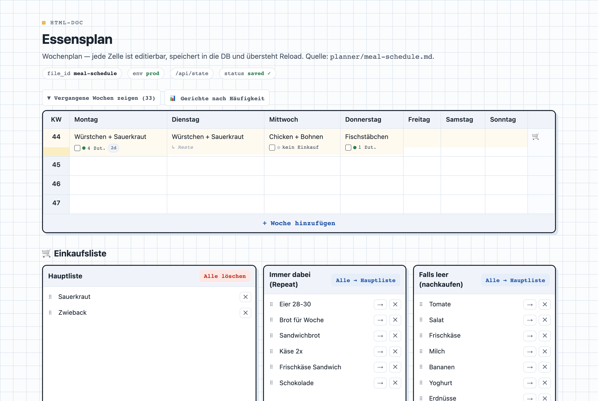
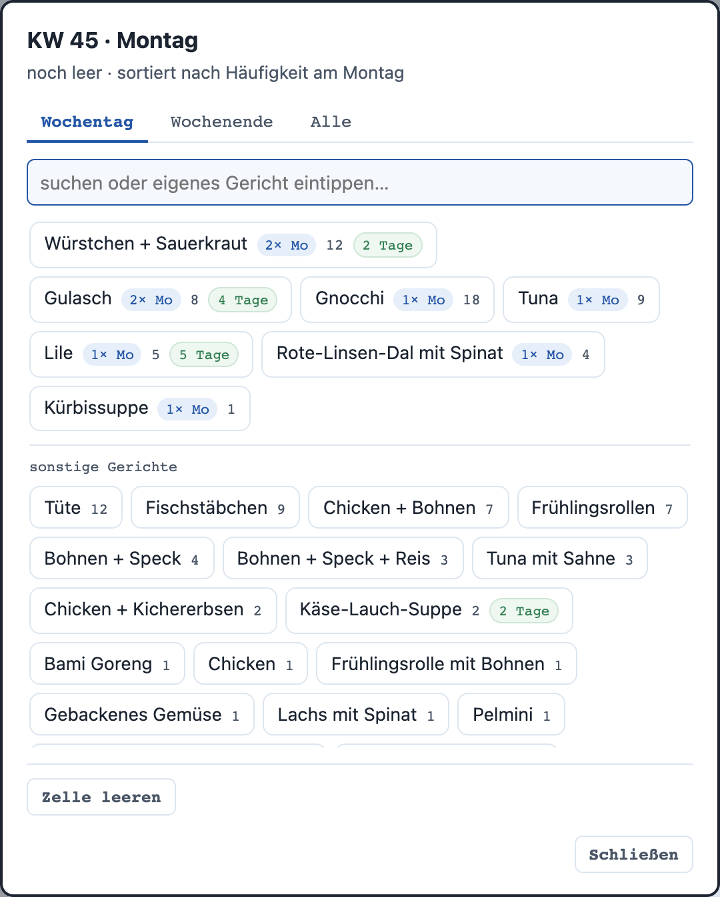
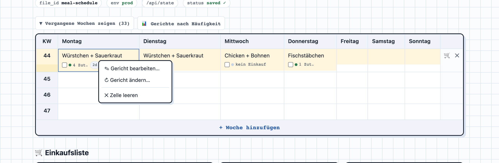
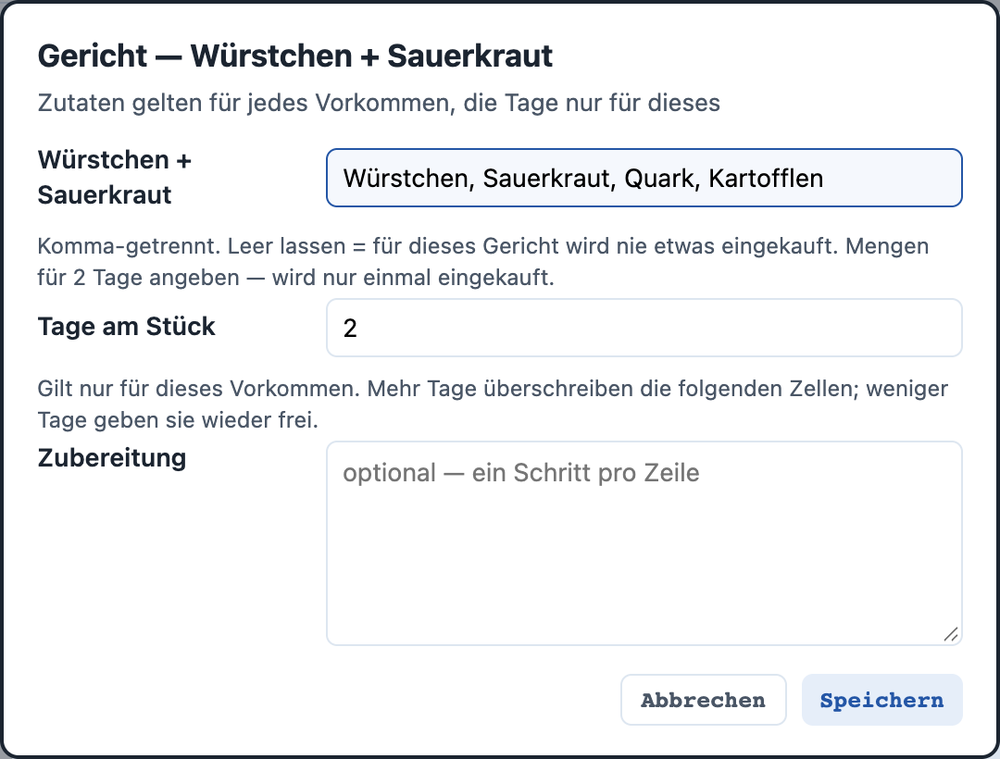
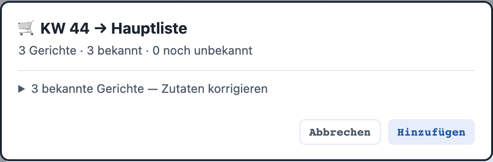
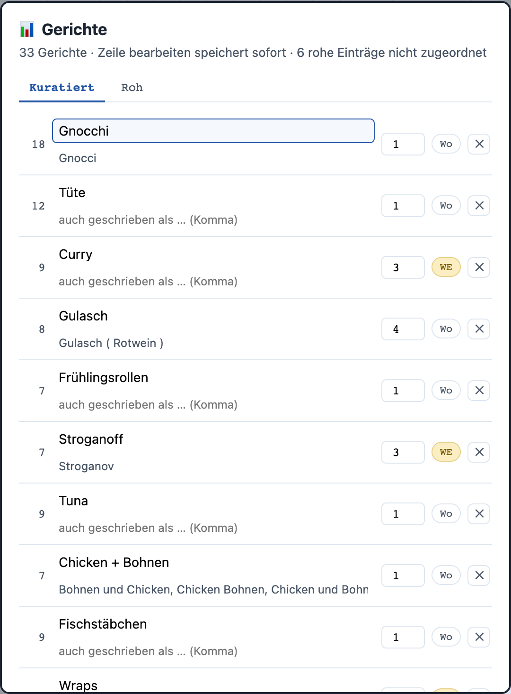
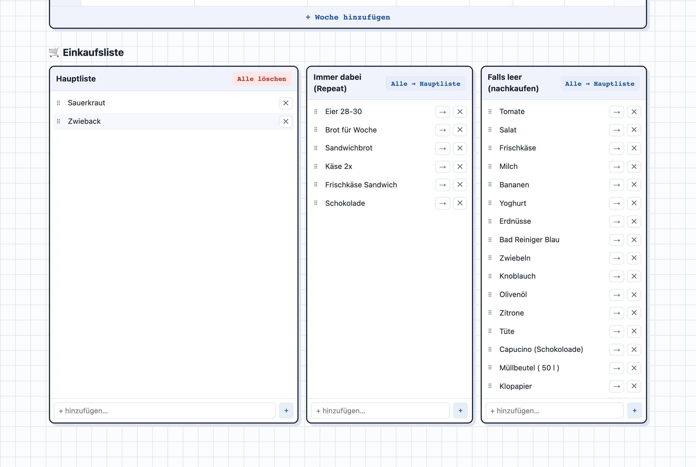
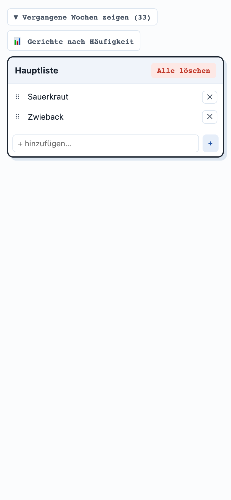
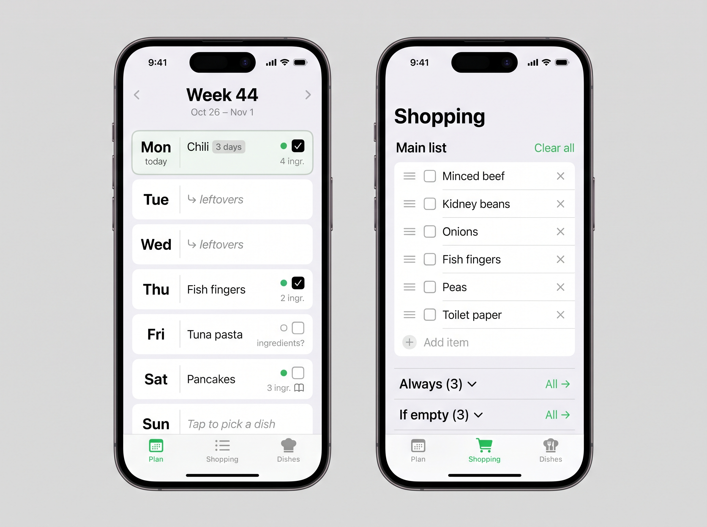

# Meal Planner — spec, phone first, ready for Capacitor

> Plan what you eat each day, and the shopping list fills itself.
> This spec describes the meal planner I use every day (screenshots below, its UI is German).
> Give this file to Claude Code and it builds the app from scratch: a **website** first, then a
> **real app on an iPhone** (no Xcode, free Apple ID, nothing paid).
> **The first version is plain on purpose.** It has to work, not look good. Making it look good is a
> separate step later, from reference images.

---

## 1 · What the app does

> The reference is German. The app you build is **English**; the words in brackets are what the
> screenshots show.

| Feature | Behaviour | Screenshot |
|---|---|---|
| Week plan | One row per calendar week, 7 columns Monday to Sunday. The current week is highlighted | `01` |
| Weeks appear by themselves | The current week and the next 3 always exist, so planning never starts with a click. "+ Add week" (+ Woche hinzufügen) adds the next one | `01` |
| Past weeks | Hidden behind "Show past weeks (33)" (Vergangene Wochen zeigen). Kept as history | `01` |
| Pick a dish | Tap a day → the dish picker | `02` |
| Cell menu | Long-press a day → Edit dish · Change dish · Clear day | `03` |
| Dish details | Ingredients, days in a row, preparation steps | `04` |
| Leftovers | A dish that lasts several days fills the following days. Those show "↳ leftovers" (Reste) and never shop | `01` |
| Buy checkbox | Under each dish: a checkbox + "4 ingr." / "no shopping" (kein Einkauf) / "ingredients?" (Zutaten?) | `01` |
| Week → list | Cart button at the end of a week row: a shortcut that **ticks every unticked first day** of that week, so the rules in §2 apply as usual (unticking a day later removes its items again) | `05` |
| Dishes overview | All dishes, how often they were eaten, their other spellings, weekday or weekend | `06` |
| Shopping lists | Main list (Hauptliste) · Always (Immer dabei) · If empty (Falls leer) | `07` |
| Saving | Every change saves by itself and survives closing the app | — |

## 2 · The details that make it useful

### Dish picker
- Tabs: **Weekday · Weekend · All**. Saturday and Sunday open on Weekend, the other days on Weekday
- A search field on top. Typing a name that doesn't exist yet shows **"Add '<name>'"**, which creates
  the dish and puts it on the day. **Enter does the same**
- Sorted by **how often this dish was eaten on this weekday**, then by how often overall. A line
  "other dishes" separates the ones never eaten on this weekday
- Each dish shows: `2× Mo` (times on this weekday), the total count, and `3 days` if it lasts longer
- "Clear day" at the bottom

### Dishes
- A dish has: **name**, **other spellings** ("Gnocci" counts as "Gnocchi"), **weekday or weekend**,
  **default days in a row** (1–7), **ingredients** (a list), **preparation** (optional, one step per line)
- Tapping a "↳ leftovers" day opens the picker. Picking a dish there **splits the run**: the earlier
  dish ends the day before (its tick stays), the new dish starts on the tapped day
- Picking a 3-day dish on Friday fills Friday, Saturday, Sunday. It **crosses into the next week**
  when needed
- The days are per occurrence: in the dish details, "days in a row" changes only this occurrence.
  More days overwrite the following days, fewer days give them back
- Renaming a dish keeps its ingredients and keeps the old name as another spelling, so the history
  still counts
- Counts include every spelling. Upper/lower case never makes two dishes
- A book icon on the day shows when the dish has preparation steps

### Ingredients are learned, not looked up
- No recipe database. The first time you tick a dish with no ingredients, the app asks for them
  once (comma separated). Leaving it empty means "never buy anything for this dish", and it never asks again
- The status dot under a dish: **green** = has ingredients, **grey** = known, nothing to buy,
  **outline** = not asked yet

### Shopping lists
- **Main list:** what you buy next. Add, edit in place, delete, reorder by drag. "Clear all"
- **Always:** things bought every time (eggs, bread). "→" moves one item to the main list, "All →" moves all
- **If empty:** things you buy only when they run out (milk, salad). Same buttons
- No duplicates on the main list: "Milk" and "milk" are the same item
- **Tick off while shopping:** every main-list item has a checkbox. A ticked item greys out and is
  struck through, and stays until "Clear all" or "Clear ticked". Ticking an item makes it yours (rule 4)

### The rules between the plan and the main list
> This is the part that was buggy in my own version. Build it exactly like this.

1. **The main list is the truth.** Nothing rebuilds it in the background
2. **Ticking a day** adds that dish's ingredients that are **not on the list yet**. The app remembers
   which items **this tick** added
3. **Unticking** removes only the items ticks added, and only if no other ticked day still needs them.
   Items you added yourself are never touched
4. **Deleting an item by hand, editing it, or "Clear all"** makes it yours. It never comes back on its own
5. **A leftover day never shops.** Only the first day of a multi-day dish has a checkbox
6. **Past weeks are history.** Their ticks stay visible but no longer hold anything on the list
7. **Changing or clearing a ticked day** first unticks it (rule 3)
8. **Changing a dish's ingredients** while it is ticked updates the list: new ingredients are added,
   removed ones go (rule 3)
9. **Cancelling** the "which ingredients?" question (Cancel, Escape, tapping outside) leaves the day unticked
10. The toast after each tick says what happened: `+3 on the main list`, `−2`, or `main list unchanged`

## 3 · Why it can't just be shrunk — the reference on a phone today

- On a phone the reference shows **only the main list**: the plan is hidden. Today I plan on the Mac
  and shop with the phone. The app must do both on the phone
- A 7-column table needs ~1,100 px. On a 390 px screen it is a sideways scroll with no overview
- Long-press and right-click: the cell menu only exists on right-click
- Drag to reorder works with a mouse only

## 4 · Phone-first layout

> Target: iPhone portrait, 390 × 844. Everything works with a thumb.

- **Three tabs at the bottom:** Plan · Shopping · Dishes
- **Plan = one week at a time.** The 7 days stacked as rows (day name left, dish right, checkbox
  under the dish). Swipe or arrows to change the week; it opens on the current week
- **Tap a day → picker as a bottom sheet.** Long-press → the cell menu as a sheet
- **Shopping tab:** main list on top; Always and If empty below, folded
- **Drag on touch:** long-press (~300 ms) a handle, then drag. Scrolling still works without the long-press
- **No confirm dialogs.** Every delete shows a short "Undo" toast instead
- **Tap targets ≥ 44 px**, no hover-only controls, inputs ≥ 16 px so iOS doesn't zoom
- **Safe areas** (notch, home indicator), `viewport-fit=cover`
- **Mobile only, no desktop view.** On a wider screen (e.g. the browser while building) the phone
  layout stays centered at phone width

## 5 · Data

- **Weeks are keyed by ISO year + week** (`2026-W44`), never the bare number, so January works
  (the reference used bare numbers and breaks at the new year)
- Gaps are allowed: a holiday week can simply not exist
- One saved document: weeks (7 days each, with a buy flag per day), dishes, the three lists, and the
  list of items that ticks added
- **Starter dishes on first start**, so the app is not empty: Chili (3 days), Spaghetti Bolognese (2),
  Curry (2), Fish fingers, Tuna pasta, Gnocchi with spinach, Pancakes (weekend), Lasagne (2, weekend),
  each with a few ingredients. "Always" starts with eggs, bread, cheese; "If empty" with milk, salad, tomatoes

## 6 · Capacitor-friendly from the first line

- **Static build only.** Vite outputs `dist/`, Capacitor's `webDir` is `dist`. No server, no API routes
- **Relative asset paths** (`base: './'`)
- **Storage: IndexedDB via `idb-keyval`**, not `localStorage` (iOS can clear WebView localStorage).
  Load is async: show the starter data only after the load finds nothing
- **No sign-in, no backend.** Your plan lives on your device
- **Native plugins are opt-in**, each one needs a new phone build. List them here before adding them

## 7 · Stack

- React + Vite + TypeScript, Tailwind, `lucide-react` icons
- Touch-capable drag and drop (e.g. `@dnd-kit` with a long-press activation)
- Capacitor for the iPhone; the phone chain is the one from my last video (kanban app → iPhone,
  SideStore, GitHub build, no Xcode)

## 7b · One app, two apps inside — shown openly

> A free Apple ID only allows 3 sideloaded apps (see the last video). So the meal planner is **not**
> a new iPhone app: it moves into the **existing kanban app** from the last video, and we say so on camera.

- The meal planner is built here, as its own web app. The kanban app's shell bundles it under
  `/meals/*`, next to `/kanban/*` (the kanban spec already nested its routes for this)
- First screen of the installed app: pick **Kanban** or **Meal Planner**. The app remembers the
  choice and opens it straight away next time; a small switch gets you back to the picker
- Same app id as before, so it takes no extra slot
- **One new phone build + SideStore reinstall** for the shell: the app is renamed **myApps** and gets a
  new icon (an app grid in the clean iOS style, green on white). After that, updates go live again

## 8 · Done when

- [ ] Everything in §1 and §2 works on the phone with touch only
- [ ] All 10 rules in "The rules between the plan and the main list" hold
- [ ] The plan survives closing and reopening the app
- [ ] Installed on the iPhone, opens from the home screen, no browser bar

## 8b · The look — picked from mockups

> Four style options were generated (Gemini) for only two screens, Plan and Shopping, in
> `mockups/`. The pick is **option B, clean iOS**. Every other view (picker sheet, cell menu,
> dish details, Dishes tab, ingredients prompt, toasts) gets the **same style**:
> no mockup per view, carry the look over.

- Light grey grouped background, white inset grouped cards, hairline separators (like Apple Reminders)
- System font (SF Pro / `system-ui`), large bold titles
- One accent: a fresh green, for the active tab, "Clear all", "All →", status dots, today's row tint
- Black checkboxes; muted grey italic for "↳ leftovers" and placeholders
- Sheets and menus are native-looking iOS bottom sheets and action sheets

## 9 · Later, not now

- **Deleting a week:** not in this version
- **Past weeks on the phone** (swipe back into them or not, editable or not): decided later from
  mockups. Until then they stay hidden behind "Show past weeks"

- **Making it look good:** a separate step after this version works — the style is already picked (§8b)
- Sync between phone and computer (needs a backend)
- Live updates without reinstalling (Capgo, see the last video)

> Your results can look different from mine, or not work the first time. That's normal — tell
> Claude Code what you see and fix one thing at a time.
